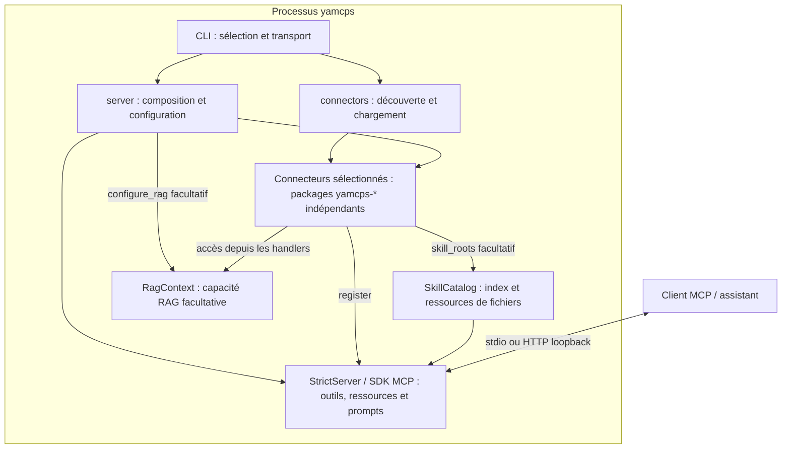
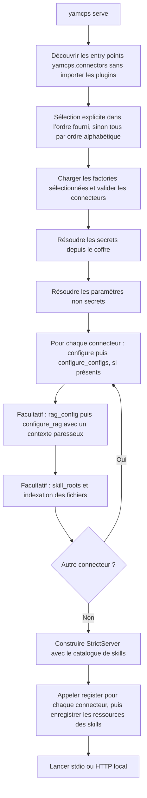
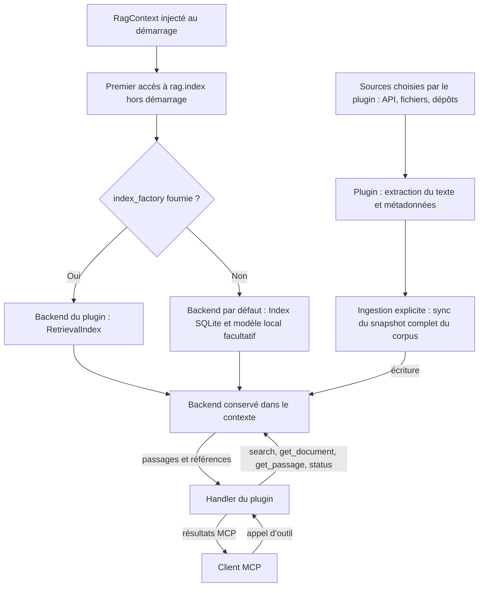

# Contribuer à yamcps

Ce document s’adresse aux développeurs du moteur et des connecteurs. Pour installer et utiliser
yamcps, consulter le [README](README.md).

- [Environnement](#préparer-son-environnement)
- [Conventions](#style-et-conventions)
- [Tests et couverture](#tests-et-couverture)
- [Vérifications](#vérifications-avant-une-pull-request)
- [Contribution](#proposer-une-modification)
- [Publication](#publication-du-package)
- [Objectifs et limites](#objectifs-et-limites)
- [Organisation et démarrage](#organisation-et-démarrage)
- [Contrat des connecteurs](#écrire-un-connecteur)
- [Configuration non secrète](#configurations-non-secrètes-des-plugins)
- [Secrets](#authentification-des-api)
  - [Secrets conditionnels](#secrets-conditionnels-à-partir-de-yamcps-040)
  - [Sources dans l’API Python](#sources-de-secrets-dans-lapi-python)
  - [Sécurité du coffre](#sécurité-et-exploitation-du-coffre)
- [Skills](#skills)
- [Distribution et compatibilité](#distribution-et-compatibilité)
- [RAG](#recherche-documentaire-et-rag-local)
- [Démonstration des secrets](#essayer-le-plugin-de-démonstration-des-secrets)

## Préparer son environnement

Python 3.12 ou supérieur est requis. Depuis la racine du dépôt :

```sh
python -m venv .venv
source .venv/bin/activate
python -m pip install -e '.[dev]' -e plugins/yamcps-demo -e plugins/yamcps-demo-secrets -e plugins/yamcps-demo-rag
python -m pip install radon bandit coverage
# Optionnel, pour le téléchargement et l’exécution des modèles sémantiques :
python -m pip install -e '.[rag]'
```

Les dépendances de développement actuelles incluent Ruff, mypy, pytest et les outils de
construction. Radon, Bandit et Coverage doivent pour l’instant être installés séparément. Les
vérifications de développement sont exécutées en local. Le workflow de publication décrit ci-dessous
publie uniquement la distribution de base.

## Style et conventions

- Suivre PEP 8 ; utiliser Ruff pour le formatage et le lint, avec la configuration
  du dépôt (Python 3.12, longueur de ligne de 100 caractères).
- Nommer fonctions et variables en `snake_case`, classes en `PascalCase`,
  constantes en `UPPER_CASE` et modules en minuscules.
- Ajouter des annotations de types aux interfaces publiques et conserver la
  vérification stricte de mypy.
- Documenter toutes les fonctions et méthodes publiques avec des docstrings au
  format Google (`Args`, `Returns`, `Raises` lorsque pertinents). Ajouter des
  exemples d’utilisation quand ils clarifient le comportement.
- Garder le contrat des connecteurs minimal ; respecter les noms `yamcps-<nom>`,
  `yamcps_<nom>` et les préfixes d’outils décrits dans la section [Écrire un connecteur](#écrire-un-connecteur).

Exemple de docstring :

```python
def normalize_message(message: str) -> str:
    """Remove surrounding whitespace from a message.

    Args:
        message: Text supplied by the caller.

    Returns:
        The message without surrounding whitespace.
    """
    return message.strip()
```

## Tests et couverture

Écrire des tests pour toute nouvelle fonctionnalité et des tests de régression pour les corrections.
Utiliser `unittest.TestCase` pour les nouveaux tests synchrones et
`unittest.IsolatedAsyncioTestCase` pour les tests asynchrones. Les modules de tests portent le nom
`test_*.py`.

La suite existante repose sur pytest et pytest-asyncio. Elle reste exécutée pendant la transition ;
pytest sait aussi collecter les classes unittest. Ne pas supprimer ses tests ni présenter la
migration comme terminée. Les nouveaux tests unittest doivent également être exécutables avec le
runner standard.

Maintenir une couverture de lignes **strictement supérieure à 80 %** sur le cœur et tous les plugins
du dépôt :

```sh
coverage run --source=yamcps,yamcps_demo,yamcps_demo_secrets,yamcps_demo_rag -m pytest -q
coverage report --show-missing --fail-under=81
python -m unittest discover -s tests -p 'test_*.py'
```

Le runner unittest seul ne collecte pas les fonctions pytest existantes : son succès ne remplace pas
celui de la suite complète. Le test HTTP nécessite de pouvoir ouvrir un port loopback.

### Organisation des tests RAG

Les tests sont regroupés par responsabilité, sans dépendance à un modèle téléchargé :

| Fichier | Périmètre |
| --- | --- |
| `tests/test_rag_index.py` | Snapshots SQLite, recherche, citations, namespaces et rollback |
| `tests/test_rag_embeddings.py` | Validation des vecteurs, chargement hors ligne et empreinte du modèle |
| `tests/test_rag_context.py` | Configuration, factories paresseuses et accès concurrents |
| `tests/test_rag_capability.py` | Déclaration et injection de la capacité dans les connecteurs |
| `tests/test_model_download.py` | Téléchargement simulé, validation des fichiers et commande CLI |
| `tests/test_demo_rag.py` | Intégrations MCP en mémoire, stdio et HTTP local |

Pour exécuter uniquement les tests du backend, du contexte, des embeddings et de l’injection avec le
runner standard :

```sh
python -m unittest discover -s tests -p 'test_rag_*.py'
```

Cette sélection ne remplace pas la suite complète : les téléchargements simulés et les intégrations
MCP restent exécutés par les commandes générales ci-dessus.

## Vérifications avant une pull request

```sh
ruff format --check src plugins .github/workflows tests
ruff check src plugins .github/workflows tests
mypy src plugins/*/src .github/workflows
radon cc src plugins/*/src .github/workflows -s -a
bandit -r src plugins/*/src .github/workflows
coverage run --source=yamcps,yamcps_demo,yamcps_demo_secrets,yamcps_demo_rag -m pytest -q
coverage report --show-missing --fail-under=81
python -m build
python -m build plugins/yamcps-demo --outdir plugins/yamcps-demo/dist
python -m build plugins/yamcps-demo-secrets --outdir plugins/yamcps-demo-secrets/dist
python -m build plugins/yamcps-demo-rag --outdir plugins/yamcps-demo-rag/dist
```

Radon sert à repérer la complexité : privilégier des fonctions simples et expliquer dans la PR toute
complexité élevée ajoutée. Aucun seuil bloquant Radon n’est configuré actuellement. Examiner les
résultats Bandit ; corriger les problèmes ou documenter précisément les exceptions justifiées.
Signaler les vérifications non exécutées au lieu de les déclarer réussies.

## Proposer une modification

1. Créer une branche dédiée et garder la modification centrée sur un objectif.
2. Ajouter ou mettre à jour les tests et la documentation concernée.
3. Exécuter les vérifications applicables et consulter le diff.
4. Ouvrir une pull request décrivant le problème, le comportement obtenu et les
   validations effectuées, avec leurs éventuelles limites.

Mettre à jour `README.md` pour la présentation et l’utilisation, et `CONTRIBUTING.md` pour le
développement, l’architecture et les contrats. Les instructions aux agents sont dans `AGENTS.md`. Ne
jamais committer de secrets ni de fichiers de configuration contenant des tokens.

## Publication du package

Le nom `yamcps` est réservé pour le projet. Les plugins `yamcps-<nom>` sont des packages
indépendants et **ne sont pas publiés** par `.github/workflows/workflow.yaml`.

Configurer une fois le Trusted Publisher du projet PyPI `yamcps` avec :

- propriétaire GitHub : `JoReci2` ;
- dépôt : `yamcps` ;
- nom du workflow : `workflow.yaml` ;
- environnement : `pypi`.

Créer également l’environnement GitHub `pypi` dans les paramètres du dépôt. Aucun token PyPI n’est
requis : seul le job de publication reçoit le droit OIDC `id-token: write`. Les opérations de
construction n’ont pas ce droit. Référence : [Trusted Publishers de
PyPI](https://docs.pypi.org/trusted-publishers/adding-a-publisher/).

Pour une release, après revue et intégration sur `main` :

1. Créer un tag `v<version>` sur un commit intégré dans `main`, par exemple
   `v0.2.0`. La version est calculée depuis Git par `hatch-vcs` : aucune modification
   de `pyproject.toml` ou du serveur n’est nécessaire. Le tag `v0.2.0` produit la
   version Python/PyPI `0.2.0` (sans le préfixe `v`).
2. Depuis le checkout propre de ce tag, construire et vérifier le package de base :

   ```sh
   python -m pip install build twine packaging
   python -m build --outdir dist/base .
   python .github/workflows/verify_release.py dist/base --tag v0.2.0
   python -m twine check --strict dist/base/*
   ```

   Utiliser un dossier de sortie vide pour chaque construction de release.
3. Pousser le tag, puis publier la release GitHub correspondante pour déclencher
   la construction et la publication PyPI.

Le workflow accepte les formats PEP 440 suivants, avec un préfixe `v` obligatoire
pour les tags Git :

| Type de version | Version Python | Tag Git |
| --- | --- | --- |
| Finale | `1.2.0` | `v1.2.0` |
| Développement | `1.2.0.dev1` | `v1.2.0.dev1` |
| Alpha | `1.2.0a1` | `v1.2.0a1` |
| Bêta | `1.2.0b1` | `v1.2.0b1` |
| Candidate à la publication | `1.2.0rc1` | `v1.2.0rc1` |
| Post-release | `1.2.0.post1` | `v1.2.0.post1` |
| Deux composantes | `23.12` | `v23.12` |
| Une composante | `42` | `v42` |

La validation compare les versions selon PEP 440 pour le wheel et le sdist.
Les variantes équivalentes sont acceptées : `v0.4.0dev1` et `v0.4.0.dev1`
correspondent à la version normalisée `0.4.0.dev1` des archives.
Elle refuse les versions différentes du tag, y compris les versions de développement
inférées entre deux tags, ainsi que tout suffixe local (`+g123`, par exemple).
Une release stable `v0.4.0` ne peut donc pas publier une archive `0.4.0.dev1`.
Les epochs (`1!1.0`) et les post-releases de préversions (`1.2.0a1.post1`,
par exemple) sont explicitement refusées.
Les tests construisent le wheel et le sdist de chacun des huit formats, puis
reconstruisent le wheel depuis chaque sdist sans Git.

Les builds depuis Git nécessitent les tags et l’historique complet (éviter les clones superficiels).
Entre deux tags ou avec des modifications locales, `hatch-vcs` calcule une version de développement ;
la vérification de release refuse de la publier si elle diffère du tag après normalisation PEP 440.
Le sdist contient les métadonnées nécessaires pour reconstruire le wheel sans Git. Une copie des
sources sans `.git` ni métadonnées de sdist ne permet pas de déterminer la version.
Le serveur annonce la version des métadonnées du package installé ; réinstaller le package après
un changement de tag, y compris en mode éditable.
Référence : [hatch-vcs](https://github.com/ofek/hatch-vcs).

Le workflow s’exécute uniquement sur une release publiée, jamais sur une PR ou un simple push. Il
vérifie l’appartenance du commit à l’historique de `main`, construit uniquement le projet racine,
puis exige exactement un wheel et un sdist dont les métadonnées déclarent `yamcps` et la version du
tag. Il transmet uniquement ces deux archives au job de publication. Les plugins ne sont ni
construits ni téléversés par ce workflow. Le sdist de base conserve uniquement les trois plugins de
démonstration pour ses tests ; aucun plugin métier externe n’y est embarqué.

Les versions PyPI sont immuables : augmenter la version pour chaque publication. Ne déclencher
aucune release ni publication sans instruction explicite.

## Objectifs et limites

Fournir un serveur MCP extensible avec un contrat de connecteur minimal et une distribution Python
standard. Le cœur `yamcps` et les plugins `yamcps-<nom>` sont des packages indépendants. La V1
utilise stdio ou HTTP local (distant avec OAuth explicite), sans rechargement à chaud ni installation de skills chez le client.

### Vue des composants

Les schémas de ce guide utilisent Mermaid et sont lisibles directement sur GitHub.
Les connecteurs s’exécutent dans le même processus que le moteur ; leur distribution
séparée ne constitue pas une isolation d’exécution.



## Organisation et démarrage

- `src/yamcps/cli.py` : commandes, sélection des connecteurs et transport.
- `src/yamcps/connectors.py` : contrat structurel et découverte des entry points.
- `src/yamcps/server.py` : composition des connecteurs et du catalogue de skills.
- `src/yamcps/configs.py` : résolution et stockage des configurations non secrètes.
- `src/yamcps/onboarding.py` : sélection et collecte des secrets requis.
- `src/yamcps/vault.py` : stockage chiffré des secrets.
- `src/yamcps/registry.py` : refus des enregistrements en double.
- `src/yamcps/skills.py` : indexation des fichiers et extension MCP Skills.
- `plugins/yamcps-demo` : distribution autonome servant d’exemple.
- `plugins/yamcps-demo-secrets` : exemple avec trois secrets déclarés, helpers Bearer/Basic
  et outil de statut local ne révélant aucun identifiant.
- `plugins/yamcps-demo-rag` : exemple de backend RAG autonome, sans réseau ni modèle.
- `tests` : tests du cœur et intégrations avec le client MCP officiel.

La CLI découvre les entry points `yamcps.connectors`. Sans `--connector`, elle charge toutes les
factories par ordre alphabétique ; sinon elle charge uniquement la sélection explicite, dans l’ordre
fourni. Une découverte vide en mode automatique est une erreur expliquant qu’il faut installer un
plugin. Le chargeur vérifie les identifiants et le contrat. Après le chargement, le démarrage suit
cet ordre :

1. Résoudre les configurations non secrètes des connecteurs sélectionnés.
2. Évaluer leurs besoins conditionnels en secrets et collecter les secrets manquants.
3. Injecter les secrets avec `configure(secrets)`, puis les configurations avec
   `configure_configs(configs)`.
4. Injecter les contextes RAG paresseux et indexer les skills.
5. Construire le serveur MCP et enregistrer les outils, prompts et ressources.
6. Lancer le transport choisi.

Une erreur de plugin empêche le démarrage. Les hooks facultatifs sont ignorés lorsqu’ils ne sont pas
déclarés.

Le serveur s’appuie sur le SDK officiel `mcp>=2.3,<3`. Les logs vont sur stderr pour préserver les
messages du transport stdio. HTTP écoute par défaut sur `127.0.0.1:<port>/mcp`.
Le mode distant exige OAuth et conserve les protections réseau du SDK.

### Ordre de démarrage

La résolution des valeurs précède la configuration de chaque connecteur. Les
étapes marquées facultatives ne s’appliquent qu’aux capacités déclarées. Les mêmes
instances de connecteurs sont conservées jusqu’à l’enregistrement des handlers.



Ce parcours décrit la commande CLI `serve` ; les sources de valeurs de l’API
Python sont détaillées dans les sections consacrées aux secrets et aux configurations.
Les champs obligatoires manquants sont demandés uniquement avec un terminal ; sinon,
le démarrage échoue avec une commande de préconfiguration. Toute erreur de plugin
interrompt ce parcours avant le lancement du transport.

## Écrire un connecteur

Convention : distribution `yamcps-github`, module `yamcps_github`, identifiant `github`. Le contrat
public `yamcps.Connector` est un `Protocol` structurel : aucun héritage requis.

```python
from mcp.server import MCPServer


class GitHubConnector:
    id = "github"

    def register(self, server: MCPServer) -> None:
        @server.tool()
        async def github_status() -> str:
            """Report connector status."""
            return "ready"
```

Dans le `pyproject.toml` du plugin :

```toml
[project]
name = "yamcps-github"
version = "0.1.0"
requires-python = ">=3.12"
dependencies = ["yamcps>=0.3,<0.4"]

[project.entry-points."yamcps.connectors"]
github = "yamcps_github:GitHubConnector"
```

Cet exemple minimal cible yamcps 0.3. Pour utiliser les secrets conditionnels, déclarer la version
minimale indiquée dans leur contrat.

La cible est une factory sans argument ; la classe ci-dessus convient directement. L’entry point
doit porter le même nom que `id`. Préfixer outils et prompts par `github_` et choisir des URI
propres au connecteur. Les doublons sont des erreurs. L’enregistrement est synchrone ; les handlers
peuvent être asynchrones. Les dépendances réseau doivent être créées et fermées dans les handlers ou
via les mécanismes de contexte du SDK ; ne pas effectuer d’appel réseau à l’import. Les paramètres
non secrets passent par `required_configs()` et `configure_configs()`. Les secrets passent par
`required_secrets()` et `configure()` ; la CLI les lit dans le coffre, sans repli sur les variables
d’environnement.

Installer le plugin avec pip : il est inclus par défaut par `yamcps serve`. Pour limiter les plugins
chargés, sélectionner leurs identifiants : `yamcps serve --connector github --connector demo`. La
découverte n’importe pas les plugins ; seules les factories sélectionnées sont chargées. Un échec de
chargement ou d’enregistrement interrompt le démarrage et identifie le plugin concerné. Les plugins
installés sont du code Python de confiance exécuté dans le processus.

Le package autonome [yamcps-demo](plugins/yamcps-demo) est un exemple complet avec Hatchling, entry
point et fichiers de skills inclus dans le wheel.

## Configurations non secrètes des plugins

`yamcps.configs` fournit `ConfigSpec`, `ConnectorConfigs` et `ConfigStore`. Les paramètres sont des
chaînes stockées dans un fichier JSON en clair, séparé du coffre chiffré. Ne jamais y enregistrer de
token ou de mot de passe.

### Déclaration et injection

Déclarer les deux hooks synchrones suivants, en complément de `id` et `register()` :

```python
from yamcps import ConfigSpec, ConnectorConfigs


class ExampleConnector:
    id = "example"
    endpoint: str
    mode: str | None

    def required_configs(self) -> list[ConfigSpec]:
        """Describe the settings requested by the setup wizard.

        Returns:
            Configuration fields in prompt order.
        """
        return [
            ConfigSpec("endpoint", "Adresse du service sans identifiants"),
            ConfigSpec("mode", "Mode de fonctionnement", default="local"),
        ]

    def configure_configs(self, configs: ConnectorConfigs) -> None:
        """Load settings before registering handlers.

        Args:
            configs: Settings scoped to this connector.
        """
        self.endpoint = configs.require("endpoint")
        self.mode = configs.get("mode")

    # Implémenter également register(server) selon le contrat minimal.
```

Sans défaut (`default=None`), un champ exige une valeur non vide. Un défaut chaîne rend le champ
facultatif ; `default=""` permet de désactiver une option. Les noms suivent le kebab-case et sont
uniques par connecteur.

Les configurations sont injectées après `configure(secrets)`, avant le RAG, les skills et
l’enregistrement des handlers. Les connecteurs sans ces hooks restent utilisables ; sans
déclaration, aucun fichier de configuration n’est lu. L’API Python accepte
`create_server(config_values={...})` pour remplacer le fichier et l’environnement, ou un
`config_store` explicite ; ces options sont exclusives. Les vues par connecteur limitent la lecture
par nom sans constituer une sandbox : les plugins sont du code de confiance.

### Stockage et résolution

Le fichier par défaut est `~/.config/yamcps/config.json`, créé seulement lors d’une écriture.
`--config-file` permet de choisir un autre fichier pour les commandes `configs`, `secrets set` et
`serve`. Les clés sont normalisées par connecteur :

```json
{
  "YAMCPS_EXAMPLE_ENDPOINT": "https://api.example.com",
  "YAMCPS_EXAMPLE_MODE": "local"
}
```

La résolution applique la valeur enregistrée, puis la variable d’environnement si la clé est
absente, puis le défaut déclaré. Une chaîne vide enregistrée prévaut sur l’environnement. Supprimer
une valeur rétablit la résolution environnement/défaut sans supprimer les données ou fichiers
désignés par cette valeur.

Au démarrage, seuls les champs obligatoires manquants des connecteurs sélectionnés sont demandés, si
un terminal est disponible. Sans terminal, un diagnostic indique la commande de préconfiguration ;
le flux MCP n’est jamais lu comme une réponse. L’assistant explicite propose tous les champs
déclarés, même ceux ayant un défaut. Une saisie vide conserve la valeur existante ou le défaut. Le
lot n’est écrit qu’après la réussite de toutes les saisies.

Un verrou d’écriture et un remplacement atomique protègent le fichier. Les commandes de
configuration ne sont pas des outils MCP. Redémarrer le serveur après une modification : aucun
rechargement à chaud n’est prévu. Pour les clients MCP, utiliser le même compte local ou fournir
explicitement le même fichier de configuration, avec des chemins absolus pour ses valeurs de
chemins.

Voir les [commandes de configuration](README.md#configs) dans le README.

## Authentification des API

Le contrat minimal reste inchangé. Pour bénéficier de la découverte et de l’assistant, un connecteur
déclare `required_secrets() -> Iterable[SecretSpec]`. Chaque `SecretSpec(name, description="")`
décrit un champ obligatoire, sans valeur ni défaut. Les noms doivent être uniques dans le connecteur
et en kebab-case ; la liste peut être vide. Pour un token : `SecretSpec("token")` ; pour Basic Auth
: `SecretSpec("username")` et `SecretSpec("password")`.

Un connecteur peut ajouter la capacité `configure(secrets: ConnectorSecrets) -> None`, synchrone,
appelée avant l’indexation des skills et `register`. Elle valide et conserve ses identifiants ;
aucune donnée d’authentification n’est ajoutée aux schémas des outils MCP.

```python
from yamcps import ConnectorSecrets, SecretSpec, TokenAuth
from mcp.server import MCPServer


class GitHubConnector:
    id = "github"
    auth: TokenAuth

    def required_secrets(self) -> list[SecretSpec]:
        """Describe the credentials requested by the setup wizard.

        Returns:
            Required API credential fields in prompt order.
        """
        return [SecretSpec("token", "GitHub API token")]

    def configure(self, secrets: ConnectorSecrets) -> None:
        """Load API credentials before registering handlers.

        Args:
            secrets: Credentials scoped to the github connector.
        """
        self.auth = secrets.token_auth()  # secret nommé token

    def register(self, server: MCPServer) -> None:
        """Register handlers that use credentials internally.

        Args:
            server: MCP server receiving this connector's handlers.
        """
        # Dans le handler qui effectue la requête HTTPS :
        # headers = {"Authorization": self.auth.authorization_header().get_secret_value()}
        # Transmettre headers au client HTTP ; ne jamais les retourner ni les logger.
```

Pour Basic Auth : `self.auth = secrets.basic_auth()` lit `username` et `password` et fournit
également `authorization_header()`. Le nom d’utilisateur ne peut pas contenir `:` ; les identifiants
sont encodés en UTF-8 avant base64. Vérifier la compatibilité d’encodage avec l’API cible.
`token_auth(name="api-token", scheme="Token")` permet un autre nom de secret ou schéma.
`require(name)` et `get(name)` donnent un `SecretStr` pour les autres formats d’API. Les tokens
doivent être non vides et composés de caractères ASCII visibles ; les noms de secrets sont en
kebab-case. Les erreurs de configuration de plugins sont limitées et leurs valeurs connues sont
masquées dans les diagnostics du démarrage. Les auteurs doivent aussi éviter de propager les
credentials ou les en-têtes dans les erreurs de leurs handlers.

`yamcps.secrets` contient les objets masqués et les vues par connecteur ; `yamcps.vault` gère le
stockage chiffré ; `yamcps.onboarding` découvre les champs, pose les questions et collecte un lot
avant son écriture atomique. La CLI choisit les chemins par défaut ou explicites et autorise
l’interaction seulement si stdin est un terminal. Les valeurs absentes déclenchent un message
d’action sans lecture de stdin en mode non interactif. Les valeurs existantes ne sont pas
redemandées au démarrage ; l’assistant explicite permet de les remplacer ou de les conserver. Les
instances des plugins sélectionnés ne sont chargées qu’une fois : la déclaration, la résolution,
`configure` et `register` utilisent les mêmes instances. Un ancien plugin sans déclaration reste
utilisable, mais ses champs doivent être préconfigurés avec `set --name` si son `configure` les
exige. Les commandes de gestion ne sont pas des outils MCP accessibles à un modèle. Un coffre
explicitement sélectionné remplace la source environnement pour l’injection. `os.environ` n’est pas
modifié. Les plugins restent du code de confiance : la vue par connecteur est une convention d’API,
pas une sandbox.

Le format binaire est `HMCPVAULT` (signature historique conservée) + version `0x01` + nonce 12
octets + ciphertext avec tag GCM 16 octets. L’en-tête est authentifié comme données associées. Le
contenu chiffré est un objet JSON de noms normalisés vers des valeurs texte. La clé de 32 octets est
produite par `AESGCM.generate_key` ; les nonces sont produits par le générateur système via
`os.urandom`. Chaque sauvegarde génère un nouveau nonce. Le coffre vise un usage local à faible
volume ; pas de service multi-utilisateur, de verrou distribué ni de stockage de clé dans le
trousseau.

Voir le [manuel utilisateur](README.md#secrets) pour les limites de protection, les sauvegardes et
la portée des références ANSSI.

### Secrets conditionnels (à partir de yamcps 0.4.0)

Le hook public facultatif synchrone `required_secrets_for_configs(configs: ConnectorConfigs) ->
Iterable[SecretSpec]` sélectionne les secrets requis à partir de la configuration résolue, sans
dépendre d’un appel préalable à `configure_configs`. `required_secrets()` reste le catalogue complet
: le résultat conditionnel contient exclusivement des `SecretSpec` de ce catalogue, identifiés par
nom, sans doublon. Les descriptions du catalogue sont utilisées pour les saisies. Sans ce hook, tous
les secrets du catalogue restent requis. Les déclarations invalides et les hooks asynchrones
provoquent un `ConnectorError` sans exposer leur diagnostic brut.

L’[ordre de démarrage](#organisation-et-démarrage) distingue la résolution des configurations de
leur injection. Le hook reçoit les valeurs résolues depuis le fichier, l’environnement et les
défauts, ou depuis `config_values` explicite. Toutes les sélections sont évaluées avant la première
demande de secret. Le hook valide lui-même la sélection métier ; le moteur ne connaît aucun service
ARR. Il ne doit faire aucun appel réseau.

Exemple à intégrer à un connecteur unique `arr` (implémenter aussi `register(server)` et
éventuellement `skill_roots()`) :

```python
from yamcps import ConfigSpec, ConnectorConfigs, ConnectorSecrets, SecretSpec


class ArrConnector:
    id = "arr"

    def required_configs(self) -> list[ConfigSpec]:
        """Declare the mandatory explicit service selection."""
        return [ConfigSpec("enabled-services", "Services activés, par exemple sonarr,seerr")]

    def required_secrets(self) -> list[SecretSpec]:
        """Return the complete credential catalogue."""
        return [
            SecretSpec(f"{service}-api-key")
            for service in ("sonarr", "radarr", "prowlarr", "seerr")
        ]

    def selected_services(self, configs: ConnectorConfigs) -> list[str]:
        """Validate the explicit service selection.

        Args:
            configs: Resolved plaintext settings.

        Returns:
            Selected service identifiers.

        Raises:
            ValueError: The selection is empty, duplicated or contains unknown names.
        """
        services = [name.strip() for name in configs.require("enabled-services").split(",")]
        allowed = {"sonarr", "radarr", "prowlarr", "seerr"}
        if (
            not services
            or any(name not in allowed for name in services)
            or len(set(services)) != len(services)
        ):
            raise ValueError("Invalid enabled-services selection")
        return services

    def required_secrets_for_configs(self, configs: ConnectorConfigs) -> list[SecretSpec]:
        """Select credentials before settings are injected.

        Args:
            configs: Resolved connector configuration.

        Returns:
            Only credentials for the selected services.
        """
        return [SecretSpec(f"{name}-api-key") for name in self.selected_services(configs)]

    def configure(self, secrets: ConnectorSecrets) -> None:
        """Retain credentials until the selected services are configured.

        Args:
            secrets: Connector-scoped credentials.
        """
        self.secrets = secrets

    def configure_configs(self, configs: ConnectorConfigs) -> None:
        """Configure only selected services before tools and skills are registered.

        Args:
            configs: Resolved connector settings.
        """
        self.services = self.selected_services(configs)
        self.api_keys = {name: self.secrets.require(f"{name}-api-key") for name in self.services}
```

Le plugin expose ensuite uniquement les outils et racines de skills de `self.services`, sous sa
responsabilité. Le moteur ne filtre pas les outils ou les skills. Ne jamais retourner ni logger
`api_keys`.

`yamcps configs set` reste indépendant des secrets. `yamcps secrets set --connector arr
--config-file /chemin/config.json` résout la sélection avant de proposer les secrets actifs ;
`--name` refuse un secret inactif ou absent du catalogue conditionnel. Sans terminal et sans
sélection requise, la commande échoue en indiquant `yamcps configs set --connector arr`, sans lire
stdin ni demander tous les secrets. Désactiver un service ne supprime aucune valeur du coffre ; sa
réactivation réutilise les secrets existants au démarrage. L’assistant explicite permet toujours de
les conserver ou de les remplacer.

Redémarrer après modification : aucun changement dynamique à chaud. Un plugin utilisant ce hook doit
déclarer `yamcps>=0.4.0,<0.5` ; ce contrat n’est pas disponible dans yamcps 0.3.0. La version 0.4.0
est la version cible de cette évolution et doit être publiée séparément avant installation depuis
PyPI.

### Sources de secrets dans l’API Python

La CLI utilise toujours le coffre, sans repli sur l’environnement ni chargement implicite de `.env`.
`create_server(..., secret_values=...)` accepte une source explicite. Sans coffre ni source
explicite, l’API Python conserve la lecture des variables `YAMCPS_<CONNECTEUR>_<SECRET>` pour
compatibilité.

### Sécurité et exploitation du coffre

Le chiffrement authentifié AES-256-GCM utilise un nonce aléatoire de 96 bits à chaque écriture et un
tag de 128 bits. Une mauvaise clé ou une altération provoque un refus de lecture. Ces choix
s’appuient sur les principes des [guides cryptographiques
ANSSI](https://cyber.gouv.fr/reglementation/reglementation-identite-confiance-numerique/securite-echanges-voie-electronique/referentiel-general-de-securite/documents-referentiel-general-de-securite/)
et l’implémentation [AESGCM de
cryptography](https://cryptography.io/en/latest/hazmat/primitives/aead/). **yamcps n’est pas un
produit qualifié ou certifié ANSSI et cette implémentation n’a pas fait l’objet d’un audit de
conformité.**

Conserver et sauvegarder la clé séparément du coffre, avec des accès restreints. La perte de la clé
rend les secrets irrécupérables. La possession du coffre et de la clé permet leur déchiffrement ; le
chiffrement au repos ne protège pas contre un processus ou un plugin compromis ayant les mêmes
droits. Les secrets sont déchiffrés en mémoire et Python ne garantit pas leur effacement sécurisé.
Basic Auth encode les identifiants en base64 : les appels API doivent utiliser HTTPS avec validation
des certificats, comme les appels avec token.

Les écritures sont atomiques et protégées par un fichier `.lock` ; elles ne permettent pas de
détecter la restauration d’une ancienne version valide du coffre. Après un arrêt brutal pendant une
modification, vérifier qu’aucune commande d’écriture n’est active avant de retirer un verrou
résiduel. Conserver une sauvegarde protégée ; la rotation de clé n’est pas automatisée dans cette
version (créer un nouveau coffre et y réenregistrer les identifiants). Les fichiers `*.yamcps-key`,
`*.yamcps-vault` et leurs verrous sont ignorés par Git. Ne jamais placer de secrets dans les
dossiers de skills, qui sont publiés via MCP.

## Skills

Implémenter facultativement `skill_roots() -> Iterable[Path]`. Chaque chemin désigne **un dossier de
skill**, contenant `SKILL.md` et ses fichiers annexes :

```python
def skill_roots(self):
    return [Path(__file__).parent / "skills" / "github-review"]
```

Le nom du dossier et le champ YAML `name` doivent être identiques, en minuscules avec tirets,
préfixés par l’identifiant du connecteur (`github-review`). Une `description` non vide est
obligatoire. Les symlinks sont refusés. Inclure les fichiers de skills dans les distributions et ne
pas y placer de secrets : tous les fichiers sous ces dossiers sont publiés.

Les fichiers sont indexés et mémorisés au démarrage : aucune lecture arbitraire de chemin
utilisateur, aucun rechargement à chaud, aucune exécution de script. Les URI sont de la forme
`skill://github-review/SKILL.md`. Les fichiers texte et binaires sont disponibles par les ressources
MCP standard ; `skills/list` et `skills/get` exposent les métadonnées et le manifeste SHA-256 avec
tailles en octets.

**Compatibilité SDK :** le SDK PyPI `mcp==2.3.0` testé fournit `Extension`, mais pas le module
`mcp.server.skills` décrit par sa documentation. `yamcps.skills` isole donc un adaptateur utilisant
cette API publique pour l’extension `io.modelcontextprotocol/skills`. La lecture reste possible avec
les ressources standard sur les clients ne prenant pas en charge cette extension. Le serveur
n’installe pas les skills dans les agents ; leur chargement dépend du client.

## Distribution et compatibilité

Hatchling produit wheel et sdist. Les fichiers de skills doivent être inclus dans le package du
plugin et accessibles depuis son installation, sans dépendre du répertoire courant. Le wheel
`yamcps-demo` valide cette organisation.

La version initiale est `0.1.0`. Toute modification incompatible du contrat exige une évolution de
version et des contraintes des plugins. L’adaptateur Skills est isolé pour permettre son
remplacement par une API native du SDK après validation de compatibilité.

Pour les changements de protocole, de contrat ou de packaging, vérifier les intégrations en mémoire,
stdio et HTTP local ainsi que l’installation des wheels hors du dépôt. Les tests couvrent notamment
découverte sans import, doublons, contrats invalides, empreintes et refus des symlinks.

## Recherche documentaire et RAG local

Le package de base `yamcps` inclut la capacité RAG dans `yamcps.rag`. Chaque plugin peut y
souscrire, comme il peut fournir des skills ou déclarer des secrets. Il n’existe plus de
distribution séparée `yamcps-rag-core` à installer.

| Composant | Responsabilité |
| --- | --- |
| `yamcps.rag` dans le moteur | Contrat de backend, contexte par plugin et implémentation SQLite par défaut |
| Plugin métier | Choisir les sources et corpus, extraire les textes et exposer les outils MCP |
| Client IA | Composer une réponse à partir des passages et de leurs références |

Le contrat minimal d’un connecteur reste `id` et `register()`. Le RAG est une capacité optionnelle :
les plugins existants n’ont pas à changer. Aucun index n’est créé et aucun modèle n’est chargé au
démarrage du serveur par le moteur. Aucun outil RAG universel n’est ajouté automatiquement.

Le protocole structurel `yamcps.rag.RetrievalIndex` permet à chaque plugin de réutiliser le backend
local ou de fournir sa propre implémentation. Ajouter un connecteur ne nécessite aucune modification
du moteur ni de liste centralisée : l’installation de son entry point `yamcps.connectors` suffit à
sa découverte.

### Flux RAG et responsabilités

Le démarrage injecte uniquement le contexte. Au premier accès à `rag.index`, ce
contexte construit le backend sous verrou et le conserve après réussite. Le schéma
ci-dessous distingue l’ingestion explicite des lectures déclenchées par le client.



Avec le backend par défaut, seule la synchronisation crée et alimente la base ;
préparer l’objet `Index` ne l’écrit pas. Le plugin expose les outils et les ressources
de citations nécessaires. Le client compose la réponse ; le moteur RAG ne réalise
ni extraction des fichiers ni génération de texte.

### Activer le RAG dans un plugin

Implémenter les deux hooks synchrones suivants :

```python
from mcp.server import MCPServer
from yamcps import RagConfig, RagContext


class MyConnector:
    id = "my-plugin"

    def rag_config(self) -> RagConfig:
        return RagConfig()

    def configure_rag(self, rag: RagContext) -> None:
        self.rag = rag

    def register(self, server: MCPServer) -> None:
        # Enregistrer les handlers métier ici. Dans un handler, utiliser
        # self.rag.index.search(...) ou self.rag.index.get_document(...).
        # L'ingestion appelle self.rag.index.sync(...) hors démarrage MCP.
        pass
```

Le serveur appelle les hooks après la configuration des secrets et des paramètres non secrets, avant
les skills et l’enregistrement des handlers. Il fournit une seule instance de `RagContext` à chaque
plugin sélectionné. Les deux hooks doivent être présents et synchrones ; une déclaration invalide
empêche le démarrage avec une erreur identifiant le plugin. Le contexte crée son backend à la
demande, sous verrou, puis conserve cette même instance lors de ses accès successifs et concurrents.
Le protocole facultatif `RagProvider` décrit les deux hooks ; les erreurs de configuration sont
signalées sans divulguer les chemins ou les secrets.

Sans chemin explicite, l’index est situé sous
`~/.local/share/yamcps/rag/<identifiant-plugin>.sqlite3`. `YAMCPS_RAG_DIR` change le répertoire de
base. `RagConfig(index_path=Path(...), model_path=Path(...))` permet au plugin de choisir une base
et un modèle local. Un chemin d’index explicite prévaut sur `YAMCPS_RAG_DIR`. Cette séparation par
défaut évite les collisions, sans constituer une sandbox ou un mécanisme d’autorisation.

Avec le backend par défaut, accéder à `rag.index` prépare l’objet et charge le modèle si demandé,
mais ne crée pas la base SQLite. Seule une synchronisation écrit les documents. Ne pas accéder à
l’index, aux sources ni au modèle dans les hooks ou dans `register()` : conserver les traitements
dans les handlers ou une commande d’ingestion séparée. Pour un handler async, déporter les
opérations bloquantes dans un thread.

### Étendre le backend RAG

Le point d’extension est une factory Python synchrone et paresseuse :

```python
from pathlib import Path
from yamcps.rag import Index, RagConfig, RetrievalIndex


def create_backend(path: Path) -> RetrievalIndex:
    return Index(path)  # Ou un backend fourni intégralement par le plugin.


# Dans rag_config() du connecteur :
config = RagConfig(index_factory=create_backend)
```

La factory reçoit le chemin résolu pour le connecteur ; un backend distant peut l’ignorer. Elle est
appelée au premier accès à `rag.index`, une seule fois après réussite, sous verrou. Un échec permet
une nouvelle tentative au prochain accès. Elle possède ses choix de modèle, découpage et stockage :
`model_path` est donc incompatible avec `index_factory`. Sans factory, SQLite et le modèle local
facultatif restent utilisés. Les hooks ne doivent pas accéder à `rag.index`.

Le contrat conserve `sync` (snapshot complet), `search`, `get_document`, `get_passage` et `status`.
Les opérations et leurs résultats doivent respecter les sémantiques du contrat de l’index, notamment
les frontières de corpus, les filtres, les citations et l’atomicité des snapshots. Les backends
synchrones doivent supporter les appels concurrents ; les handlers async déportent leurs opérations
bloquantes dans un thread. Aucun cycle de vie de client réseau persistant n’est fourni par ce
contrat : utiliser des ressources bornées à chaque opération.

Un backend alternatif peut être livré dans un dépôt externe ; ses dépendances ne sont pas imposées
au package de base.

#### Plugin de démonstration

Le package [yamcps-demo-rag](plugins/yamcps-demo-rag/README.md) constitue un exemple sans réseau ni
modèle. Il illustre la factory, l’injection paresseuse, une ingestion explicite et la résolution de
citations.

### Utilisation directe en Python

Les primitives RAG sont aussi utilisables depuis un script Python avec le package de base :

```sh
python -m pip install -e .
```

Exemple complet, sans modèle d’embeddings ni accès réseau :

```python
from pathlib import Path

from yamcps.rag import Document, Index

index = Index(Path("data/example.sqlite3"))
corpus = "demo/specifications"

documents = [
    Document(
        corpus=corpus,
        document_id="SSS-DEMO",
        revision="1.2",
        text="SSS-REQ-0042 : le système doit sauvegarder sa configuration chaque soir.",
        metadata={"type": "SSS", "baseline": "v1", "status": "approved"},
    )
]

# Créer l'index et synchroniser la liste complète des révisions du corpus.
print(index.sync(corpus, documents))

hits = index.search(
    "SSS-REQ-0042",
    corpus,
    filters={"baseline": "v1", "status": "approved"},
    limit=5,
)
for hit in hits:
    print(hit.document_id, hit.revision, hit.source_uri)
    print(hit.text)
    print(index.get_passage(hit.passage_id).indexed_at)

source = index.get_document(corpus, "SSS-DEMO", "1.2")
print(source.text)
print(index.status(corpus))
```

L’exemple crée `data/example.sqlite3` dans le répertoire courant. `Document.text` contient le
**texte déjà extrait** : la bibliothèque ne lit pas elle-même les PDF, DOCX, API ou dépôts. Cette
extraction appartient au plugin ou au script appelant. Le nom du corpus est une chaîne de
classement, pas un chemin de dossier.

#### Synchronisation et conservation des versions

**`Index.sync(corpus, documents)` reçoit un snapshot complet du corpus, pas une liste de documents à
ajouter.** Une révision absente de cette liste est supprimée. Une liste vide efface tous les
documents de ce corpus. Les autres corpus restent inchangés. Pour conserver plusieurs révisions, les
fournir toutes à chaque appel.

La synchronisation retourne `updated`, `unchanged` et `deleted`. L’empreinte tient compte du
contenu, des métadonnées et du découpage ; un document identique évite le recalcul de ses passages
et embeddings. Les changements d’un corpus sont transactionnels : une erreur d’embedding annule les
mises à jour de l’appel.

Le découpage par défaut fait au plus 1200 caractères par passage, sans chevauchement. `chunk_size`
accepte une valeur de 64 à 16000 dans `sync()`. Une modification du contenu, des métadonnées ou du
découpage change les identifiants des passages concernés : relancer la recherche pour obtenir leurs
nouvelles références.

#### Résultats et références

Chaque `SearchHit` fournit notamment `passage_id`, `corpus`, `document_id`, `revision`,
`source_uri`, `text`, `start`, `end`, `indexed_at`, `metadata` et `score`. Les offsets `start`
inclus et `end` exclu désignent des caractères du texte extrait, pas les pages du fichier d’origine.
Le score sert au classement, sans représenter une probabilité de vérité.

Les filtres sont des égalités sur les métadonnées, combinées par ET. La recherche exige un corpus
explicite, une requête non vide de 4000 caractères maximum et une limite de 1 à 20 résultats. Sans
passage correspondant, elle retourne une liste vide.

`Document.source_namespace` choisit le schéma des références de source, par exemple
`polarion://source/...` ou `demo-rag://source/...` ; il participe à l’identité du document. Le
plugin doit enregistrer la ressource MCP correspondante s’il souhaite que ces références soient
lisibles via MCP. Le défaut reste `docs`. Ce namespace n’est pas un contrôle d’accès. Garder les
bases séparées : deux plugins partageant un fichier et un corpus pourraient remplacer mutuellement
leurs snapshots.

Configurer aussi `Index(source_namespace="mon-plugin", path=path)` pour résoudre les documents de ce
namespace ; les documents d’un autre namespace sont refusés à l’ingestion. Une base existante avec
un autre namespace est également refusée.

### Télécharger un modèle pour l’utiliser localement

Le moteur propose une commande explicite de téléchargement depuis Hugging Face. Elle n’est pas
exposée au modèle comme outil MCP et ne s’exécute jamais au démarrage.

Installer l’extra `rag` pour télécharger les modèles, les charger localement et calculer les
embeddings :

```sh
python -m pip install -e '.[rag]'
```

Exemple avec un modèle Sentence Transformers multilingue :

```sh
yamcps models download sentence-transformers/paraphrase-multilingual-MiniLM-L12-v2
```

La commande affiche le chemin absolu du dossier local. Par défaut, il se trouve sous
`~/.local/share/yamcps/models/<organisation>--<modele>/<commit>`. Définir `YAMCPS_MODELS_DIR` pour
changer la racine. Une destination explicite permet de choisir le dossier à transférer sur une
machine hors ligne :

```sh
yamcps models download sentence-transformers/paraphrase-multilingual-MiniLM-L12-v2 \
  --revision main --destination /chemin/vers/un-nouveau-dossier
```

`--revision` accepte une branche, un tag ou un commit ; la commande résout cette révision en commit
avant de télécharger. `yamcps-model.json` conserve le dépôt, la révision demandée et le commit
obtenu. Le téléchargement préfère les poids Safetensors lorsqu’ils sont disponibles, avec un repli
sur les poids binaires. Les exports ONNX/OpenVINO et fichiers Python ne sont pas téléchargés. Le
format attendu est un pipeline de modules standards Sentence Transformers avec `modules.json` ; les
modules Python personnalisés ne sont pas pris en charge. La validation vérifie sa structure et la
présence de poids ; elle ne charge pas le modèle et ne mesure pas sa qualité sémantique.

`yamcps models download` utilise le module `yamcps.rag.download`. Un verrou par destination évite
les écritures concurrentes. Les métadonnées Hub temporaires sont retirées pour préserver l’empreinte
locale du modèle.

Les fichiers sont préparés dans un dossier temporaire, puis publiés sous leur chemin final seulement
après validation. Une destination existante n’est pas écrasée. En cas d’erreur, les fichiers
partiels de cet essai sont retirés. Cette V1 ne propose pas de reprise des téléchargements
interrompus, de mise à jour ou de suppression automatique des modèles.

Pour un dépôt privé ou à accès restreint, fournir `HF_TOKEN` dans l’environnement et disposer des
droits nécessaires sur Hugging Face. Aucun token n’est accepté comme argument CLI ou écrit dans le
manifeste. Sans `HF_TOKEN`, la requête est anonyme. Les erreurs affichées n’incluent pas les
diagnostics bruts du fournisseur.

Fournir le dossier dans `RagConfig(model_path=Path(...))` pour utiliser le modèle. Télécharger un
modèle ne l’active pas automatiquement et ne réindexe aucun corpus. Après copie du dossier vers une
machine hors ligne, utiliser son nouveau chemin local et installer aussi les dépendances Python de
l’extra `rag` sur cette machine. Le chargement reste en mode local, sans code distant ni
téléchargement implicite. Un nouveau modèle exige un nouvel index.

Références : [API de téléchargement Hugging
Face](https://huggingface.co/docs/huggingface_hub/en/package_reference/file_download) et [fiche du
modèle
d’exemple](https://huggingface.co/sentence-transformers/paraphrase-multilingual-MiniLM-L12-v2).

### Recherche lexicale ou hybride

Sans fournisseur d’embeddings, le mode est **lexical** : classement par recouvrement de tokens,
utile notamment pour les identifiants d’exigences. Il ne comprend pas les synonymes. SQLite stocke
alors documents et passages sans vecteurs.

Pour activer les embeddings, installer l’extra optionnel :

```sh
python -m pip install -e '.[rag]'
```

Avec un modèle Sentence Transformers déjà disponible localement, remplacer la construction de
l’index Python par :

```python
from pathlib import Path

from yamcps.rag import Index, LocalSentenceTransformer

embedder = LocalSentenceTransformer(Path("/chemin/absolu/vers/modele-local"))
index = Index(Path("data/example-hybrid.sqlite3"), embedder=embedder)
```

Appeler ensuite `sync()` et `search()` comme dans l’exemple précédent, avec la même configuration.
Le mode hybride combine recouvrement lexical et cosinus des vecteurs à poids égaux. Aucun modèle
n’est fourni ou téléchargé automatiquement ; le dossier local doit contenir un modèle compatible. Le
chargement de code distant est désactivé. La qualité sémantique dépend du modèle choisi et reste à
évaluer sur vos questions.

Un index possède **une seule configuration d’embeddings**, partagée entre ses corpus. Utiliser le
même modèle pour ingestion et recherche. L’adaptateur calcule une empreinte des fichiers du modèle ;
changer de modèle ou passer du lexical à l’hybride exige un nouvel index et une réindexation. Le
protocole `Embedder` permet un autre fournisseur avec `identity: str` et `embed(text) ->
list[float]` ; son identité doit changer avec son modèle/prétraitement, et ses vecteurs doivent être
finis, non nuls et de dimension constante.

### Limites et erreurs courantes

Les limites suivantes concernent le backend SQLite fourni par défaut ; un backend personnalisé
possède ses propres caractéristiques de recherche.

- **Index absent** : appeler `sync()` en Python avant toute lecture.
  Les opérations de lecture ne créent pas la base.
- **Configuration incompatible** : vérifier le mode et le modèle utilisés. Choisir
  une nouvelle base pour un autre modèle plutôt que de mélanger les espaces vectoriels.
- **Ancien passage introuvable** : sa source a pu changer ou être retirée ; refaire
  une recherche et consulter les nouvelles références.
- **Recherche lente** : la V1 parcourt les passages du corpus en mémoire. Elle vise
  les petits corpus, sans moteur ANN, BM25, reranker ou cache de réponses.
- **Source et permissions** : SQLite conserve les contenus en clair. Les corpus et
  filtres ne constituent pas des autorisations multi-utilisateur. L'index est une
  copie ; la date des passages ne certifie pas la fraîcheur du référentiel source.

Le module RAG n’ajoute aucun traitement OCR ni génération de réponse. Il est inclus dans le wheel de
base `yamcps` publié par le workflow PyPI. Les plugins et les dépendances de l’extra `rag` ne sont
pas embarqués dans ce wheel.

L’ingestion incrémentale, le partage des modèles, la recherche fédérée et le cycle de vie des
backends persistants restent des capacités futures distinctes.

### Migration de la première version de la branche RAG

Remplacer les imports `yamcps_rag_core` par `yamcps.rag` et installer `yamcps` au lieu de la
distribution séparée. Pour réutiliser un ancien index, fournir son chemin à `Index` ou
`RagConfig.index_path` : le format SQLite reste inchangé. Utiliser un environnement virtuel neuf ou
retirer l’ancienne distribution.

Le [contrat de configuration](#configurations-non-secrètes-des-plugins) décrit `required_configs()`,
`configure_configs()`, le fichier JSON et les priorités de résolution.

## Essayer le plugin de démonstration des secrets

Depuis la racine du dépôt :

```sh
python -m pip install -e . -e plugins/yamcps-demo-secrets
yamcps serve --connector demo-secrets
```

Le premier lancement demande un token, un nom d’utilisateur et un mot de passe. Utiliser des valeurs
fictives : ce plugin ne contacte aucune API. Après connexion avec un client MCP, appeler
`demo_secrets_status` sans argument pour vérifier le chargement et la construction locale des
authentifications Bearer et Basic. L’outil retourne uniquement le statut et les schémas, jamais les
valeurs.

```sh
yamcps secrets set --connector demo-secrets
yamcps secrets delete --connector demo-secrets --name token
yamcps serve --connector demo-secrets
```

La première commande ouvre l’assistant complet ; après la suppression du token, le prochain
lancement ne demande que ce champ. Le skill `skill://demo-secrets-check/SKILL.md` décrit l’outil.
Pour un client sans terminal, exécuter d’abord la commande `secrets set` dans un terminal. Voir le
[README du plugin](plugins/yamcps-demo-secrets/README.md).


## OAuth du transport HTTP

`yamcps.oauth` fournit `OAuthConfig` et `JWTTokenVerifier`. La CLI charge le fichier
avant les connecteurs et refuse un bind distant sans OAuth. `create_server(oauth=...)`
injecte ensemble `AuthSettings` et le vérificateur dans le SDK MCP. La validation
RS256 impose signature, émetteur exact, audience égale à l’URL publique `/mcp`,
expiration, date d’émission, sujet, client et scopes. Le SDK protège le transport,
annonce les métadonnées RFC 9728 et lie le jeton à la ressource.

La clé publique est locale, de type RSA et d’au moins 2048 bits ; aucune URL issue
d’un jeton ne déclenche de téléchargement. PyJWT réutilise cryptography déjà requis.
Le fichier OAuth ne contient pas de secrets et n’utilise pas le vault des plugins.
Le serveur d’autorisation externe gère PKCE, consentement et renouvellement ; ne pas
confondre ce mode avec un fournisseur de comptes intégré. Le contrat des plugins
reste identique. Les autorisations sont globales pour le serveur, pas par outil.

Le transport conserve la protection DNS rebinding avec le Host et l’origine HTTPS
publics comme seules valeurs autorisées. Le déploiement doit garder le backend
inaccessible hors du reverse proxy TLS. Voir le README pour le parcours utilisateur
et les limites de rotation/révocation. `tests/test_oauth.py` couvre configuration,
jetons invalides, découverte, initialisation MCP autorisée et refus HTTP/CLI.

Référence : [autorisation du SDK MCP](https://github.com/modelcontextprotocol/python-sdk/blob/main/docs/run/authorization.md).

## Logs du moteur et des connecteurs

La CLI configure un handler Python sur stderr (date, niveau, nom du logger).
`yamcps serve --verbose` active DEBUG dans la hiérarchie `yamcps` ; les bibliothèques
tierces conservent leur niveau habituel pour éviter leurs traces de payloads HTTP/MCP.
Sans cette option, le niveau est INFO. L’API Python ne configure aucun handler :
l’application hôte reste responsable du logging. Aucun hook de plugin supplémentaire
n’est requis ; les connecteurs existants restent compatibles. Pour participer :

```python
import logging

logger = logging.getLogger("yamcps.connectors.my-api")
logger.debug("Starting synchronization")
logger.info("Synchronization completed")
```

Ne pas installer de handler, modifier le niveau ou désactiver la propagation dans
un connecteur. Réserver DEBUG aux étapes de diagnostic et INFO aux événements
utiles en exploitation ; WARNING/ERROR signalent les anomalies. Le plugin demo
illustre une trace pendant un appel d’outil. Les logs ne sont pas des notifications
MCP envoyées au client.

Ne jamais journaliser les secrets, valeurs de configuration, arguments/résultats
d’outils, corps HTTP, en-têtes d’authentification ou exceptions brutes susceptibles
de les contenir, même en DEBUG. Le moteur ne journalise que ses étapes et les
identifiants des connecteurs ; il ne peut pas assainir les messages arbitraires
des plugins, qui restent du code de confiance.

## Présentation CLI et édition interactive

`terminal.py` centralise la présentation Rich : détection du terminal, respect de
`NO_COLOR`, cellules traitées comme du texte littéral (pas de markup interprété).
Les invites vont sur stderr, avec les saisies de secrets toujours assurées par
`getpass`. Les listes vont sur stdout uniquement pour leurs commandes explicites ;
aucune interface plein écran ne s’ouvre lors de `serve`. `connectors list` découvre
les entry points sans importer les plugins. `configs list` charge les déclarations
`ConfigSpec` des plugins sélectionnés pour afficher description, défaut et valeur
stockée, sans appeler leurs hooks de configuration ni collecter leurs secrets.
Les champs inconnus sont conservés et listés dans la vue globale.

`editor.py` utilise prompt-toolkit et le lexer JSON de Pygments pour une application
plein écran portable. Rich, prompt-toolkit et Pygments sont des dépendances directes
car ils fournissent respectivement les tableaux, l’édition clavier et la coloration.
L’extra dev ajoute les stubs de Pygments pour mypy strict. Les références sont la
[documentation prompt-toolkit](https://python-prompt-toolkit.readthedocs.io/en/stable/pages/full_screen_apps.html)
et le [lexer JSON de Pygments](https://pygments.org/docs/lexers/#pygments.lexers.data.JsonLexer).

Le buffer de l’éditeur reste en mémoire, sans éditeur externe ni fichier temporaire
plaintext pour les secrets, sans historique persistant. `SecretMask` masque le texte
des valeurs, y compris les lignes JSON incomplètes, avant rendu et préserve les
positions du curseur. Le stockage contient les vraies valeurs, jamais les caractères
de masquage. Le mode plein écran utilise le buffer alternatif et l’efface à la
sortie. Les messages d’erreur JSON donnent uniquement ligne/colonne ou diagnostic
générique, jamais le contenu saisi. `Ctrl+S` valide un objet de chaînes sans clés
dupliquées ; `Ctrl+Q`/`Ctrl+C` annulent. Les secrets vides sont refusés. Pour supprimer
une valeur, retirer sa clé. L’éditeur n’est pas un export plaintext du coffre.

La portée d’un `--connector` correspond à l’ensemble exact des clés calculées depuis
ses déclarations, pas à un simple préfixe qui pourrait inclure un autre connecteur
au nom voisin. Les anciennes clés non déclarées et les autres connecteurs sont
préservés ; l’édition globale permet de les gérer sans importer les plugins. Les
configurations manquantes ont leur défaut (ou une chaîne vide) dans le buffer ; les
secrets manquants sont à remplir ou retirer. Le catalogue complet `required_secrets`
est utilisé pour éditer le coffre, indépendamment des fonctionnalités actives ;
les règles conditionnelles du wizard et du démarrage restent inchangées.

Les méthodes `ConfigStore.update` et `Vault.update` acceptent désormais `remove`
(pour les suppressions groupées) et `expected` (snapshot original). La comparaison
au snapshot est effectuée sous le verrou d’écriture exclusif, avant toute mutation.
Le contrat existant reste compatible ; sans `expected`, les mises à jour continuent
à fusionner les valeurs comme auparavant. Les ajouts, modifications et suppressions
d’une session constituent une seule transaction avec remplacement atomique. Une
concurrence, une validation invalide ou une annulation ne réécrit pas le fichier
existant. Le coffre n’est initialisé qu’au premier enregistrement de secrets.

`tests/test_terminal_editor.py` couvre les tableaux et sorties redirigées, les
métadonnées et invites, les scopes exacts, la préservation des inconnus, le JSON,
le masquage, les conflits et échecs d’écriture. Il pilote aussi une vraie application
prompt-toolkit avec une entrée pipe pour vérifier les touches de sauvegarde et
annulation. Les tests MCP historiques restent exécutés pour vérifier le transport.
