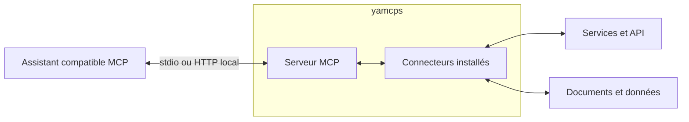

# yamcps — Yet Another Model Context Protocole Server

**yamcps** est un serveur MCP Python extensible qui expose les fonctionnalités de
connecteurs à des assistants compatibles avec le Model Context Protocol.
Python 3.12 ou supérieur est requis.



Vous installez les connecteurs adaptés à vos sources. yamcps expose leurs outils,
ressources et prompts à votre assistant via une interface MCP commune.

## Table des matières

- [Fonctionnalités](#fonctionnalités)
- [Quickstart](#quickstart)
- [Connecter un client MCP](#connecter-un-client-mcp)
- [Configuration et commandes](#configuration-et-commandes)
- [Consulter les skills](#consulter-les-skills)
- [Résoudre les erreurs courantes](#résoudre-les-erreurs-courantes)
- [Dépôts des plugins](#dépôts-des-plugins)
- [Développement](#développement)

## Fonctionnalités

- Connecteurs indépendants : outils, ressources et prompts MCP.
- Skills et fichiers associés accessibles via MCP.
- Configuration locale en JSON et coffre chiffré avec saisie interactive des secrets.
- RAG facultatif : indexation et recherche lexicale ou sémantique locale.
- Transports stdio et Streamable HTTP local.

## Quickstart

Python 3.12 ou supérieur et un client compatible MCP sont requis.
Créer un environnement virtuel, puis installer yamcps :

### Windows (PowerShell)

```powershell
py -3.12 -m venv .venv
.\.venv\Scripts\python.exe -m pip install yamcps
```

### Unix (Linux / macOS)

```sh
python3 -m venv .venv
.venv/bin/python -m pip install yamcps
```

Installer ensuite au moins un connecteur dans ce même environnement, selon les
instructions de son dépôt. Yamcps fournit le serveur ; les connecteurs fournissent
les outils et ressources utilisables par votre assistant.

Les commandes suivantes supposent un environnement activé. Sinon, remplacer
`yamcps` par `.\.venv\Scripts\yamcps.exe` sous Windows ou `.venv/bin/yamcps`
sous Unix, et `python` par l’exécutable Python du même environnement.

```sh
yamcps connectors list
# Si le connecteur demande des secrets ou des paramètres obligatoires :
yamcps secrets set --connector <identifiant>
yamcps configs set --connector <identifiant>
```

Remplacer `<identifiant>` par le nom affiché pour le connecteur installé.
Configurer ensuite le client avec l’un des transports ci-dessous.

## Connecter un client MCP

### Stdio

Le client MCP lance lui-même le serveur. Pour un client acceptant `mcpServers`,
utiliser l’une des configurations suivantes avec un chemin absolu.

#### Windows

```json
{
  "mcpServers": {
    "yamcps": {
      "command": "C:\\chemin\\vers\\.venv\\Scripts\\yamcps.exe",
      "args": ["serve"]
    }
  }
}
```

#### Unix

```json
{
  "mcpServers": {
    "yamcps": {
      "command": "/chemin/absolu/vers/.venv/bin/yamcps",
      "args": ["serve"]
    }
  }
}
```

Stdio est le transport par défaut. Les logs sont envoyés sur stderr ; stdout
est réservé au protocole MCP. Configurer les secrets et paramètres obligatoires
dans un terminal avant de lancer le client : voir la [configuration](#configuration-et-commandes).

### HTTP (Streamable HTTP)

Démarrer le serveur dans un terminal et le laisser ouvert.

#### Windows (PowerShell)

```powershell
.\.venv\Scripts\yamcps.exe serve --transport http --port 8000
```

#### Unix

```sh
.venv/bin/yamcps serve --transport http --port 8000
```

Dans le client MCP, choisir Streamable HTTP et renseigner
`http://127.0.0.1:8000/mcp`. Adapter le port si nécessaire et arrêter le serveur
avec `Ctrl+C`.

HTTP reste local, sans authentification, avec les protections DNS rebinding du
SDK. Le serveur ne propose pas de paramètre pour écouter sur une interface publique.

## Configuration et commandes

Les exemples avec `my-api` supposent un connecteur installé sous cet identifiant.
Afficher l’aide avec `yamcps <commande> --help`.

### `connectors`

```sh
yamcps connectors list
```

Afficher les connecteurs disponibles. Sans connecteur installé, le serveur
ne peut pas démarrer.

### `secrets`

Les secrets sont conservés dans un coffre local chiffré. Depuis un terminal,
le démarrage demande uniquement les valeurs manquantes des connecteurs chargés.
Depuis un client MCP sans terminal, les configurer au préalable :

```sh
yamcps secrets set --connector my-api
yamcps secrets set --connector my-api --name token
yamcps secrets list
yamcps secrets delete --connector my-api --name token
```

`set` demande les valeurs avec saisie masquée ; une saisie vide conserve une valeur
existante. Les modifications sont enregistrées une fois toutes les saisies réussies.
`list` affiche uniquement les noms. Aucun secret ne se transmet avec `--value`.

Le coffre et sa clé sont créés au premier enregistrement :

- Coffre : `~/.local/share/yamcps/secrets.yamcps-vault`.
- Clé : `~/.config/yamcps/keys/master.yamcps-key`.

`yamcps secrets init` permet aussi de les créer explicitement, sans écraser les
fichiers existants. Pour choisir d’autres emplacements, fournir ensemble
`--vault <chemin>` et `--key-file <chemin>` aux commandes `secrets` et `serve`.
Utiliser les mêmes chemins et le même compte local pour configurer et démarrer
le serveur. Redémarrer après une modification.

Sauvegarder la clé séparément du coffre : sa perte rend les secrets irrécupérables.
Protéger les accès à ces fichiers, y compris leurs ACL sous Windows. Ne jamais
placer de secrets dans Git ou dans les dossiers de skills accessibles au client.
Le chiffrement au repos ne protège pas contre un processus ayant accès au coffre
et à sa clé. Yamcps n’est pas un produit qualifié ou certifié ANSSI.

### `configs`

Gérer les paramètres non secrets dans un fichier JSON local :

```sh
yamcps configs set --connector my-api
yamcps configs list
yamcps configs delete --connector my-api --name endpoint
```

`set` ouvre l’assistant pour les champs déclarés par le connecteur.
Pour enregistrer une valeur sans interaction :

```sh
yamcps configs set --connector my-api --name endpoint --value https://api.example.com
```

Le fichier par défaut est `~/.config/yamcps/config.json`. L’option `--config-file`
permet d’en choisir un autre. Ne jamais y enregistrer de secrets.
Une valeur enregistrée prévaut sur une variable d’environnement, puis sur le
défaut du connecteur. Supprimer une valeur rétablit cette résolution sans effacer
les fichiers qu’elle désigne. Redémarrer le serveur après une modification.

### `models`

Un modèle sémantique est facultatif : l’installer uniquement si un plugin utilisé
en a besoin pour sa recherche sémantique. Consulter sa documentation pour choisir
un modèle compatible et le configurer. La recherche lexicale fonctionne sans modèle.

Installer l’extra `rag`, puis télécharger un modèle compatible avec le plugin :

```sh
python -m pip install 'yamcps[rag]'
yamcps models download sentence-transformers/paraphrase-multilingual-MiniLM-L12-v2
```

L’extra `rag` fournit les dépendances de téléchargement et d’exécution du modèle.
L’argument `repo_id` désigne le dépôt du modèle ; `--revision` choisit sa version
et `--destination` son dossier local. La commande retourne le chemin du modèle téléchargé : le
renseigner
dans la configuration du plugin, puis ingérer les documents dans un nouvel index.
Le téléchargement n’active pas le modèle automatiquement et le serveur ne
télécharge aucun modèle au démarrage.
Pour un transfert hors ligne, télécharger le modèle sur une machine connectée,
puis copier son dossier vers la machine du serveur. Installer aussi `yamcps[rag]`
sur cette machine et configurer le plugin avec le nouveau chemin local.

### `serve`

Lancer le serveur avec les configurations et secrets enregistrés :

```sh
yamcps serve
yamcps serve --connector my-api
yamcps serve --transport http --port 8000
```

| Option | Rôle |
| --- | --- |
| `--connector` | Sélectionner un connecteur ; option répétable |
| `--transport` | Choisir `stdio` (par défaut) ou `http` |
| `--port` | Choisir le port HTTP (8000 par défaut) |
| `--config-file` | Choisir le fichier JSON des paramètres non secrets |
| `--vault` et `--key-file` | Choisir ensemble le coffre et sa clé |

Sans `--connector`, tous les connecteurs installés sont chargés par ordre
alphabétique. Répéter cette option pour en sélectionner plusieurs, dans l’ordre
fourni. Redémarrer le serveur après l’installation d’un connecteur.

## Consulter les skills

Les skills fournis par les connecteurs sont consultables comme ressources MCP. Les clients prenant
en charge l’extension
`io.modelcontextprotocol/skills` peuvent découvrir les skills avec `skills/list`
et obtenir leur manifeste avec `skills/get`.

Les skills sont des instructions et des fichiers consultables : yamcps ne les
installe pas dans les agents et n’exécute pas leurs scripts. Leur utilisation
dépend des fonctionnalités du client. Redémarrer le serveur après toute
modification des fichiers ou installation d’un plugin.

## Résoudre les erreurs courantes

- **Commande introuvable** : activer l’environnement virtuel ou utiliser le chemin
  absolu de son exécutable `yamcps`.
- **Connecteur inconnu** : vérifier son installation dans le même environnement
  que yamcps et consulter `yamcps connectors list`.
- **Erreur de chargement ou d’enregistrement** : consulter stderr ; le diagnostic
  identifie le connecteur. Vérifier ses dépendances et sa configuration.
- **Port occupé** : choisir un autre port avec `--port` et adapter l’URL du client.
- **Skill absent** : vérifier que son connecteur est sélectionné et que le client
  sait lire les ressources MCP ou l’extension Skills.

HTTP est destiné à une utilisation locale ; ne pas l’exposer sur Internet.

## Dépôts des plugins

| Plugins | Dépôt |
| --- | --- |
| Documents / RAG métier | [yamcps-docs](https://github.com/JoReci2/yamcps-docs) |
| Sonarr, Radarr et Prowlarr | [yamcps-arr](https://github.com/JoReci2/yamcps-arr) |
| Skills de développement | [yamcps-extras](https://github.com/JoReci2/yamcps-extras) |

## Développement

Le [guide de contribution](CONTRIBUTING.md) regroupe les informations destinées
aux développeurs : architecture, API, contrats des connecteurs et validations.
